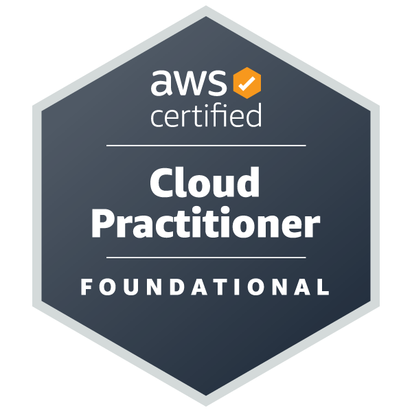

  

  

 

## 🧑‍💻 About Me

I’m a **Senior DevOps Engineer** focused on building scalable, reliable, and secure infrastructure across **cloud and on-premises environments**.

I can design and build infrastructure from the ground up, automate deployments and operations, implement CI/CD pipelines, and establish monitoring and security practices across the entire infrastructure lifecycle.

Working in an organization with a strong focus on **cybersecurity, critical infrastructure, and secure digital technologies** has also strengthened my interest and hands-on experience in **DevSecOps, vulnerability management, infrastructure hardening, and offensive security**.

* 🚀 Design and build **infrastructure from scratch**
* ☁️ Cloud & **on-premises infrastructure**
* ☸️ Kubernetes, Docker, Helm & Rancher
* 🏗️ Terraform & Ansible for Infrastructure as Code
* 🔄 Jenkins, GitHub Actions & GitLab CI/CD
* 📊 Prometheus, Grafana, Loki, New Relic & Dynatrace
* 🔐 DevSecOps, infrastructure security & vulnerability management
* 🔎 Vulnerability assessment and security scanning
* 🛡️ Infrastructure hardening and security remediation
* 🎯 Hack The Box **Seasons 10 & 11**
* 🧠 Continuously expanding my expertise in **Cloud Security, DevSecOps & Offensive Security**

## 🏢 Current Role

  
Senior DevOps Engineer

Cloud • On-Premises • Kubernetes • DevSecOps • Cybersecurity

Building, automating, securing, and operating infrastructure for mission-critical environments.

 

## 🛠️ Tech Arsenal

### ☁️ Cloud & Infrastructure

### ☸️ Containers & Kubernetes

### 🔄 CI/CD & Automation

### 📊 Observability & Monitoring

### 🛡️ Cybersecurity & DevSecOps

### 🐧 Systems & Networking

 

## 🛡️ Cybersecurity & DevSecOps

My DevOps experience extends into **DevSecOps and offensive security**, with a focus on securing infrastructure while understanding how systems can be assessed and attacked.

### 🔍 Vulnerability Management

* **Tenable Nessus** — vulnerability scanning, assessment & remediation
* Vulnerability assessment and risk analysis
* Security finding remediation and verification
* Infrastructure security hardening
* Linux security configuration and hardening
* SSL/TLS security assessment
* Security patching and vulnerability management

### 🎯 Penetration Testing & Reconnaissance

* **Nmap** — network discovery, enumeration & service scanning
* **Burp Suite** — web application security testing
* **Metasploit Framework** — exploitation and security validation
* **BloodHound** — Active Directory attack-path analysis
* **Wireshark** — network traffic analysis
* **OWASP ZAP** — web application security testing
* Linux / Kali Linux security tooling
* CTFs and hands-on security labs

### 🔐 DevSecOps

* SAST / DAST / SCA
* Secrets management with **HashiCorp Vault**
* Secure CI/CD pipelines
* Container & Kubernetes security
* Infrastructure hardening
* Vulnerability management and remediation
* Security scanning integrated into development and deployment workflows
 

## 🏆 Hack The Box

  

  

**Hands-on experience through Hack The Box labs, machines, challenges and security scenarios.**

 

## 📜 Certifications

 

## 📊 GitHub Stats

 

## 🚀 Currently Exploring

🔐 **DevSecOps & Cloud Security**
☁️ **AWS Security & Cloud Architecture**
🛡️ **Penetration Testing & Offensive Security**
🎯 **Hack The Box & CTFs**
🤖 **AI-assisted Security & Pentesting**
☸️ **Kubernetes Security**

 

## 📫 Let's Connect

  

💬 **Interested in DevOps, DevSecOps, Cloud, Kubernetes, or Cybersecurity? Let's connect and collaborate. 🤝**

 

<!--
**Fahd-DevOps/Fahd-DevOps** is a ✨ special ✨ repository because this README.md
appears on your GitHub profile.
-->
